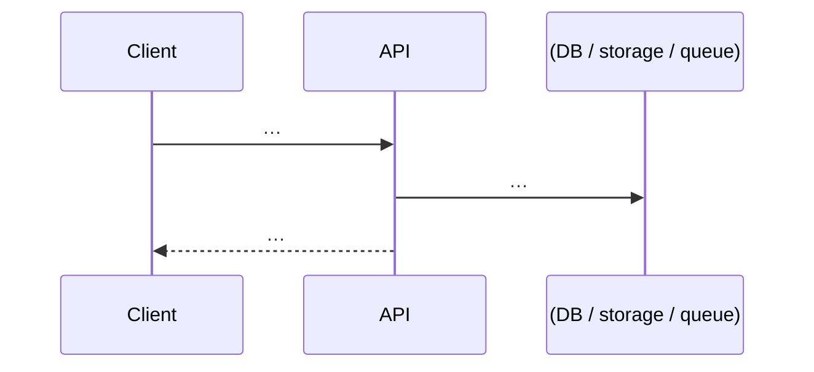
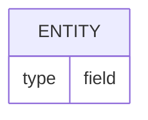

# Technical Design (Framing) — <Feature>

Status: draft (<date>)
Sources: <decision record> · <spec> · <issues/tasks>

> This doc covers **how** we build it. The **what/why** lives in the decision
> record and the spec — don't copy them, link to them.

## 1. Technical summary

3–5 lines: the chosen approach and its pillars (reuse X, new entity Y, new job Z).
Technical non-goals (what we deliberately don't build).

## 2. Architecture & integration points

Requirement → concrete anchor in the codebase (each verified, cite `file:line`):

| Need | Anchor (file:line) | Reuse / New |
|---|---|---|
| … | … | … |

## 3. Flow (sequence diagram)

(Add a component diagram if it helps.)

## 4. Data model

ERD or schema of the entities created/changed: fields, types, nullability,
indexes, relationships, delete behavior. Note any migration constraints **as
defined by this project's conventions**.

## 5. API / interface contracts

Per endpoint or interface: signature, auth/scope, input → output shape, error
cases, limits. Call out anything that deviates from the project's standard pattern.

## 6. Cross-cutting concerns

Security/privacy, performance (indexes, N+1, fan-out), observability, background
jobs (dev + prod wiring), migration/rollback — per this project's conventions.

## 7. Open questions — resolution

Re-take every open question from the spec/issues and settle it:

| Question | Evidence (file:line) | Verdict |
|---|---|---|
| e.g. does helper X exist? | `path:Lnn` | ✅ Resolved / ⚠️ TODO: add it |

## 8. Implementation plan

| Issue | Title | Effort | Depends on |
|---|---|---|---|
| 01 | … | S/M/L | — |

Recommended order + critical path. Parallelizable lots. Cross-cutting prerequisites
to do early.
