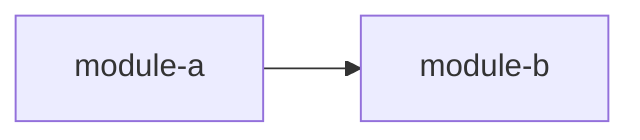
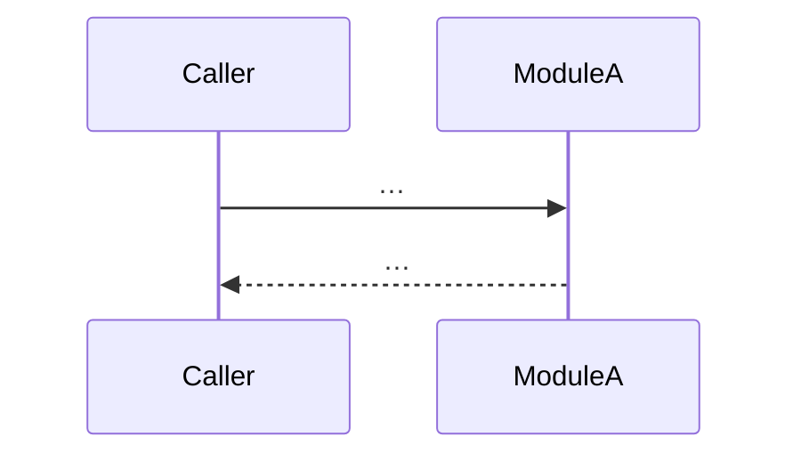
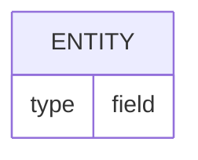

# Architecture (as-is) — <repo>

Generated: <date> · Target: `<target>` · Commit: `<short sha or "not a git repo">`

> Describes what the code **does today**, from evidence only. Every structural
> claim cites `path:line` relative to the repo root. Claims marked
> `⚠️ inferred` are not proven and are listed in "Open questions".

<!-- Fixed structure: keep all 11 sections, in this order, with this numbering.
     Translate headings into the document language. A section that does not
     apply says "N/A" and why — it is never removed. -->

## 1. Summary

3–6 lines: what the repo is, what it does, how it is shaped (monolith, library,
CLI, collection of services…), and its main runtime.

## 2. Stack & tooling

| Concern | Choice | Evidence |
|---|---|---|
| Language / runtime | … | `path:line` |
| Frameworks / key libraries | … | `path:line` |
| Build / package manager | … | `path:line` |
| Tests | … | `path:line` |
| CI / containers | … | `path:line` |

## 3. Module map

| Module | Purpose | Entry / key file | Depends on | Evidence |
|---|---|---|---|---|
| … | … | `path` | … | `path:line` |

## 4. Entry points

| Entry point | Kind (CLI, HTTP server, worker, cron, library export, command…) | Evidence |
|---|---|---|
| … | … | `path:line` |

## 5. Key flows

3 to 5 flows. If fewer exist, say so here and why.

### 5.1 <Flow name>

One line: trigger → outcome. Evidence: `path:line`, `path:line`.

## 6. Data model

Entities persisted (DB, files, caches), with evidence. `N/A` if there is none.

## 7. API & contracts

Endpoints, CLI commands, public functions, events, file formats — signature,
input → output, errors. Evidence per item.

## 8. External integrations & config/env

| Integration / setting | What it is used for | Evidence |
|---|---|---|
| … | … | `path:line` |

## 9. Risks, debt & sensitive areas

Observations only (no recommendations), each with evidence: security-sensitive
code, missing tests, dead code, duplication, agent-directed instructions found
in the repo.

## 10. Open questions

Every `⚠️ inferred` claim from the sections above, plus what would confirm it.

| # | Inferred claim | Section | What would confirm it |
|---|---|---|---|
| 1 | … | … | … |

## 11. Appendix — sources & verification report

### Sources read

- `path` — why it was read.

### Verification report

Independent verifier sub-agent, run on the draft before writing.

| Verified | Corrected | Demoted | Total |
|---|---|---|---|
| n | n | n | n |

| # | Section | Claim (short) | Old reference | Outcome | New reference | Why |
|---|---|---|---|---|---|---|
| 1 | … | … | `path:line` | corrected / demoted | `path:line` / — | … |

(or "none" when nothing was corrected or demoted)
